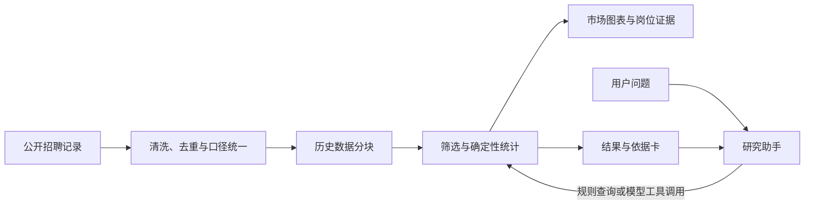

# 职业观测站 | Career Market Observatory

**用可追溯的招聘样本，帮助求职者探索岗位、比较城市，并理解每个结论的依据。**

[在线体验](https://career-market-observatory.shx7962.chatgpt.site/) · [研究助手设计](RESEARCH-ASSISTANT.md) · [数据与查询说明](QUERY-ENGINE.md) · [部署与本地运行](makers/README.md)

## 项目简介

面对岗位信息分散、薪资口径不统一、比较结果难以追溯的问题，职业观测站把公开招聘记录整理为一个可筛选、可视化、可核对来源的研究工作台。项目收录 **69,465 条历史招聘记录**，支持按职业、城市、薪资和岗位要求等条件分析。

面向求职者，工作台可以帮助回答“不同城市的数据分析岗位薪资如何”“某方向通常有哪些技能要求”等问题；面向产品和数据岗位的面试官，本仓库展示了数据口径、交互设计、确定性查询与 AI 助手的实现。

> 数据为历史样本，不代表全市场或实时在招岗位。筛选条件和薪资披露情况会影响结果；请通过岗位原链接核对当前信息。

## 功能展示

### 市场分析

按方向与城市筛选，查看薪资、岗位数量和要求分布；图表提供样本量、计算口径及岗位依据。


### 研究助手

输入自然语言问题，使用站内规则查询，或在服务配置就绪时使用模型对话。助手结合程序计算的结果组织回答，并提供可查看的依据；支持带着条件继续追问、导出研究记录和本地聊天归档。


*截图为开发阶段的示例，展示的样本范围和内容随筛选条件及版本变化。*

## 主要功能

- **职业与市场探索**：按职业方向、城市、薪资、学历与经验等条件筛选；通过地图、图表及岗位明细查看样本。
- **薪资与岗位比较**：比较不同方向或城市的样本与薪资分布，保留各组筛选条件和有效薪资样本量。
- **可追溯研究助手**：将问题转为受限查询，再由确定性分析程序计算结果；模型负责理解和解释，不直接编造统计数字。
- **结果保存与导出**：支持收藏、浏览器内聊天记录、研究记录导出及岗位来源核对。

## 实现思路

Cloudflare 版现已提供受限 Text-to-SQL：模型生成参数化查询，Worker 在 D1 内执行并计算统计、返回岗位证据。数据迁移、本地运行、API、安全边界与上线步骤见 [Text-to-SQL 实施与运行说明](TEXT-TO-SQL.md)。本地规则查询、图表和离线导出继续使用公开分片。Makers 版保留原 PostgreSQL 会话适配与浏览器工具查询协议。



前端使用 JavaScript、TypeScript 和 ECharts 展示数据与交互；原站服务端使用 Vinext / Cloudflare Worker 和 D1，研究助手通过服务端对接 DeepSeek。仓库还提供基于 PostgreSQL 的 [Makers 适配](makers/README.md)。

模型只读调用查询工具；数值和样本由程序计算，模型解释可能出错，应结合依据卡和原始岗位核对。无模型配置时可使用站内规则查询。

## 快速体验与运行

直接打开 [在线工作台](https://career-market-observatory.shx7962.chatgpt.site/)，进入“研究助手”，可以尝试：

- “比较深圳和杭州的数据分析岗位薪资”
- “换成上海，其他条件不变”

本地运行可使用仓库中的 Makers 适配（需要 Node.js 及 npm）：

```bash
git clone https://github.com/Lan-shx/career-market-observatory.git
cd career-market-observatory/makers
npm ci
npm test
npm run dev
```

默认地址为 `http://127.0.0.1:8788`。本地浏览和规则分析不需要模型密钥；模型研究对话需要单独配置 PostgreSQL 和 DeepSeek。配置方式及限制见 [Makers 运行文档](makers/README.md)。仓库更新不会自动改变在线站点。

## 关键目录

| 位置 | 内容 |
| --- | --- |
| [public/](public/) | 工作台前端、数据资源与研究助手界面 |
| [public/research-assistant.js](public/research-assistant.js) | 研究助手交互、查询与结果呈现 |
| [lib/research-server.mjs](lib/research-server.mjs) | 模型调用、工具流程与会话处理 |
| [app/api/research/](app/api/research/) | 原站研究助手 API 入口 |
| [makers/](makers/) | Makers 部署适配及 PostgreSQL 会话存储 |
| [qa-research-server.mjs](qa-research-server.mjs) | 研究助手服务端测试 |

## 数据口径与边界

- 数据来自公开招聘记录，经过清洗、去重与分类；每条记录的来源和时间以原始信息为准。
- 薪资统计使用有效披露样本；有效月薪样本少于 10 条时不展示工资统计。
- 本项目没有完整的市场供给数据、投递人数或连续历史快照，因此不据此推断全市场增长、竞争强度或个人录用概率。

更多设计、验证与历史迭代记录可见 [项目设计](DESIGN.md)、[数据能力说明](DATA-CAPABILITY.md) 和 [开发记录](docs/development-history.md)。
